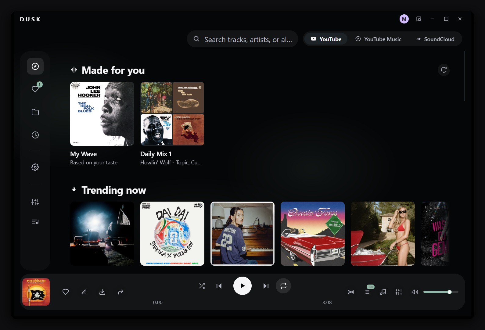
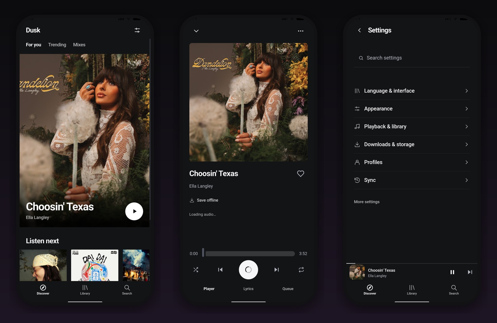
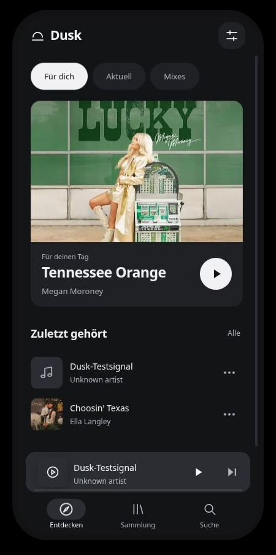
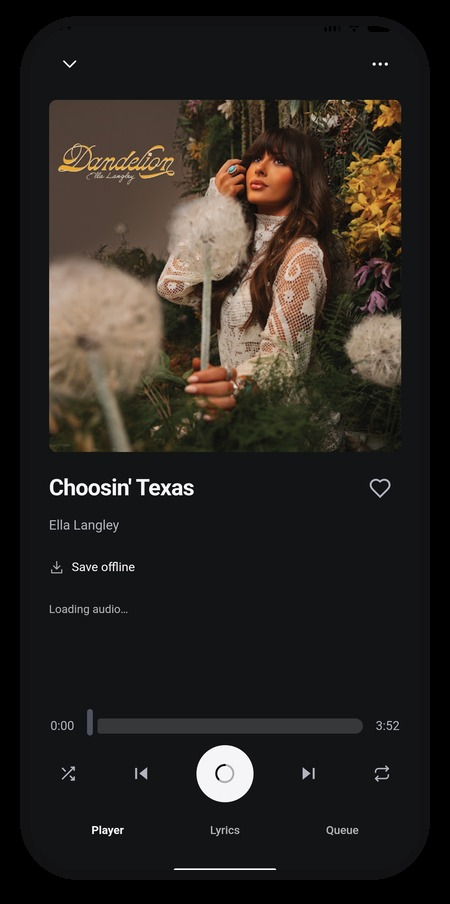
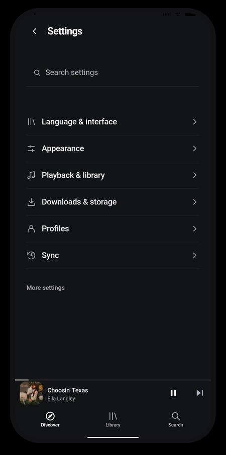

# Dusk Music

**A free music player for everyone.**

No ads. No account. No subscription. Stream from YouTube, YouTube Music, and SoundCloud, keep a local library, download for offline listening, and enjoy lyrics, EQ, and themes — on **Windows**, **iPhone**, **Android**, and in the **browser**.

Dusk Music is an **independent** open-source project ([MIT](LICENSE)) by [zxypablo11](https://github.com/zxypablo11). It is not Riff, not Muriel, and not affiliated with those projects. It does not host music. Use it for private listening, and only keep tracks you have the right to keep. See [LEGAL.md](LEGAL.md).





<p align="center">
  
  
  
</p>

## Download

Latest release: **[v1.3.10](https://github.com/zxypablo11/Dusk-Music/releases/tag/v1.3.10)**

| Platform | File |
|----------|------|
| **Windows** | [Dusk-Music-Setup-Windows-x64.exe](https://github.com/zxypablo11/Dusk-Music/releases/download/v1.3.10/Dusk-Music-Setup-Windows-x64.exe) |
| **iPhone** | [Dusk.ipa](https://github.com/zxypablo11/Dusk-Music/releases/download/v1.3.10/Dusk.ipa) (unsigned — sign with SideStore / AltStore / Sideloadly) |
| **Android** | [Dusk.apk](https://github.com/zxypablo11/Dusk-Music/releases/download/v1.3.10/Dusk.apk) (builds via Actions — may appear shortly after each push) |

Site: https://zxypablo11.github.io/Dusk-Music/

## Platforms

| Platform | What you get |
|----------|--------------|
| **Windows** | Native desktop shell (Tauri) — sidebar, playbar, volume, optional Discord presence |
| **iPhone** | Capacitor IPA — lock screen / Control Center friendly after sideload |
| **Android** | Capacitor APK — download above, or `bash tools/build-dusk-android.sh` |
| **Browser** | Local preview of the shared UI |

One player core; each shell fits the device. Technical notes: [DUSK.md](DUSK.md).

## Build from source (browser)

Requires Node.js 22+.

```sh
npm ci
node tools/build-locales.mjs
node mobile/build.mjs
node mobile/dev-server.mjs
```

Open http://127.0.0.1:5173  
Run tests with `npm test`.

## Windows desktop

```sh
cd desktop
npm install
npm run dev
```

Release build:

```powershell
cd desktop
powershell -File scripts/build-windows.ps1
```

Details: [desktop/README.md](desktop/README.md).

## iPhone

Build an unsigned IPA (Actions or a Mac with Xcode), then sign it with your sideloading tool. See [DUSK.md](DUSK.md#phone-ios--android).

## Notes

Local files and confirmed streams work well. YouTube may still block some requests (“bot” / sign-in). Treat catalog streaming and offline YouTube as best-effort until you verify on your machine.
